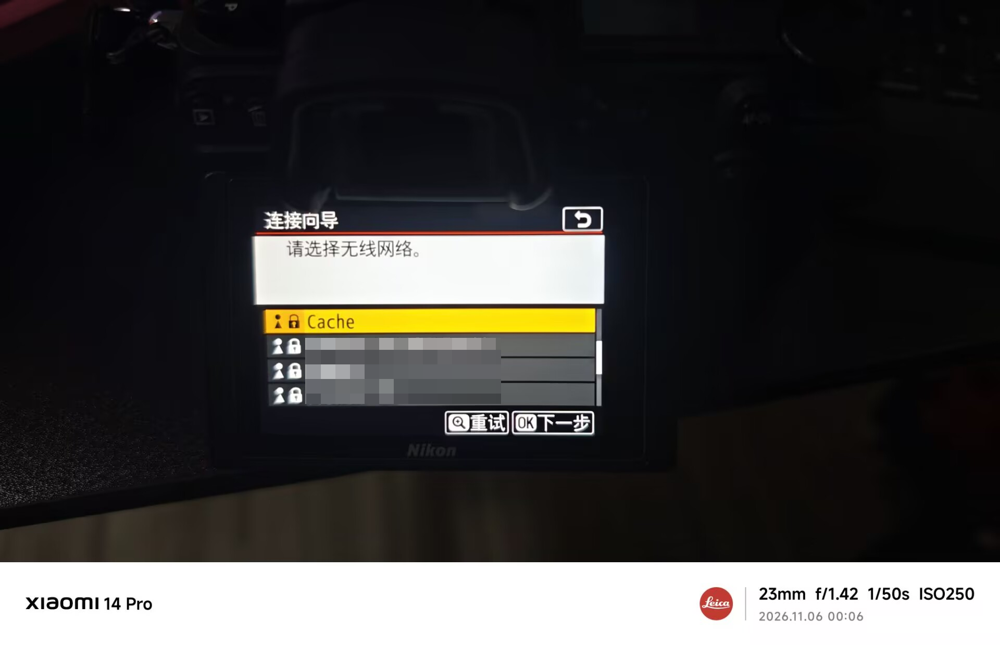
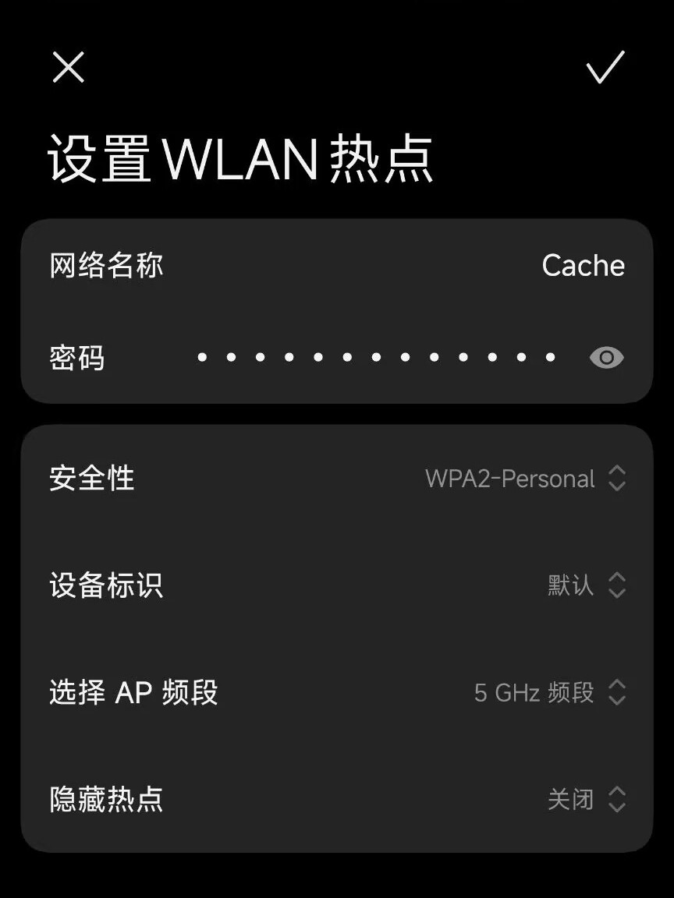

# 水平仪＋直方图同框＋九宫格＋STA 5 GHz

适用于 Nikon Z7 II 原厂 C1.70 整包固件。此文件夹的 `patch.py` 独立运行，生成包含同屏、九宫格及 STA 5 GHz 修改的版本；仅依赖 Python 3 标准库。

在当前文件夹的 PowerShell 中运行：

```powershell
& 'C:\Users\15056\AppData\Local\Programs\Python\Python312\python.exe' .\patch.py 'D:\Temporary\2610\24\z72\Z7_2_0170.bin'
```

默认在脚本所在文件夹生成 `Z7_2_0170.bin`。可用 `-o 'D:\其他目录\Z7_2_0170.bin'` 指定新输出文件；拒绝覆盖已有文件，拒绝将输入作为输出。

- 原厂整包：48,494,024 字节，SHA256 `fc0e94f57500a1f0e287c6b9a036c81a5ffceccb8432a377d645b3fa35a19b6a`。
- 修改整包：48,494,092 字节，SHA256 `540a67097a10dbee53e88449a1e43bf5898fff3acb925e1d992489c4f848fc11`。
- 修改 master：SHA256 `f572b9e7c7bbd62f99e431cca32756be36b2ac880d68b56a7b2a77af7f135846`。

脚本校验原厂整包及 master 的 SHA256、修改前字节、修改后 master 和整包的 SHA256，并检查成员及容器 CRC、编码往返以及输出文件读回。输出与本次实机验证固件逐字节一致。

## 功能与修改范围

- 水平仪＋直方图同框：修改两处 DISP 判断、九个可见性掩码，增加 68 字节跳板代码。
- 九宫格：将三条原厂网格配置记录中的横、竖线数从 3 改为 2，共六个 16 位字段；通过原厂 d10「构图网格显示」开启，沿用原厂像素对齐。
- STA 5 GHz：将 22 个有效无线国家配置项改为 `US/-1`，保留配置索引及无效项。相对同屏＋九宫格版，实际改变 132 字节表数据及 2 字节 master CRC；未新增 Wi-Fi 驱动或代码。

STA 指相机连接外部路由器或手机热点。本修改不改变相机自建热点的 AP 频段逻辑，不提供 5 GHz AP 功能；`US/-1` 也不代表所有 5 GHz 信道均可用。

只修改 master，其他四个成员逐字节保留。重新计算 master 与容器 CRC，并使用对应实测整包的固定 20 字节更新摘要。此摘要仅适用于脚本生成的精确内容；更改补丁后必须重新构建和验证，不能仅修改 SHA256 常量。本脚本不包含私有签名材料，也不提供任意固件签名功能。

## 实机测试

**2026-11-06，项目提供者反馈此版本在本人使用的 Nikon Z7 II 上实机测试可用。** 手机热点 `Cache` 设置为 5 GHz，相机连接向导可扫描到该热点。图片记录扫描结果与手机设置；连接可用性依据项目提供者的实测反馈。





相机版本字符串仍为 C1.70。尚未验证所有 5 GHz 信道、传输速率或长期稳定性。脚本只在本地生成文件，不连接或刷写相机。验证范围为该设备上实际测试的使用场景，刷机风险详见[项目风险说明](../../README.md)。
